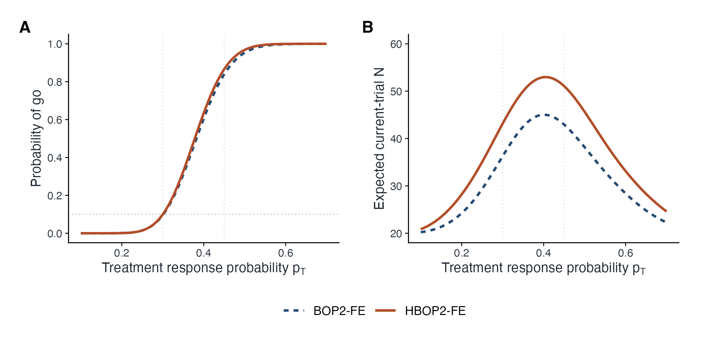
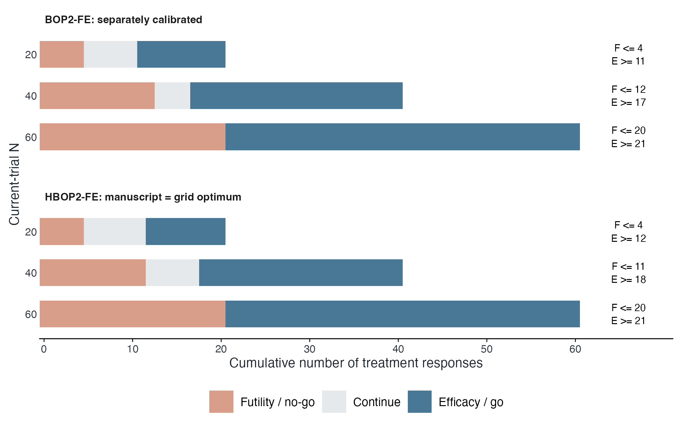

# HBOP2-FE: simulation and illustrative case study

[](https://github.com/yuexi706/HBOP2_FE/actions/workflows/reproduce.yml)

Reproducible **R analysis repository** for manuscript `HBOP2FE_Design__Yuexi__v1 (29).pdf`, Sections 2-5. This is an independent implementation of the supplied manuscript, with a fixed completed external control arm (ECA), exact design calibration, and independent Monte Carlo validation. It is not a patient-data analysis or a clinical design recommendation.

**Start with [the rendered report](results/report.html), [the user guide](docs/user_guide.md), or [the generated manuscript results](docs/manuscript_results.md).** Download the repository to view the HTML report and its linked figures locally. GitHub itself does not render arbitrary HTML as a webpage.

## Reproduce

Run from this directory, using R >= 4.4.1:

```sh
Rscript --vanilla scripts/install_dependencies.R
Rscript --vanilla tests/run_tests.R
Rscript --vanilla scripts/run_analysis.R
Rscript --vanilla scripts/verify_release.R
```

The default is the **full manuscript run**: all 13,000 boundary parameter sets for every calibration, and **100,000 independent current trials per scenario-design combination**. There are 114 combinations, or 11.4 million simulated trials, across the two primary methods, 12 borrowing configurations and six case-study design objects. Repeated design objects are retained deliberately to audit the manuscript-supplied case parameters and equivalent configurations. The number of unique decision policies is smaller.

For a smoke run, `Rscript --vanilla scripts/run_analysis.R --quick` uses 2,000 trials per combination but keeps the complete exact calibration grid. **This replaces the local generated results with clearly labeled smoke results. Rerun the default command to restore full outputs.** The release verifier rejects smoke results.

For the recorded dependency versions, install `renv` and run:

```r
renv::restore(lockfile = "renv.lock", prompt = FALSE)
renv::load()
source("scripts/run_analysis.R")
```

When running an activated renv project through `Rscript --vanilla`, explicitly load it first: `Rscript --vanilla -e 'renv::load(); source("scripts/run_analysis.R")'`. The workflow follows the [official setup-renv action](https://github.com/r-lib/actions/tree/v2/setup-renv) and explicitly loads that library before execution. It uses Ubuntu 24.04 and installs the system libraries needed for font shaping and graphics before restoring the locked R packages. Check the workflow badge above for the current cloud validation status.

The core statistical engine uses base R (`stats`); rendering uses ggplot2, patchwork, ragg and svglite. A Cairo-enabled R build is required for vector PDF export. A first dependency installation may need system font/text libraries on Linux. No downloaded clinical data, Python, LaTeX installation, or network connection is needed for the analysis after R dependencies are installed. Booktabs LaTeX table files include captions and notes; add `\usepackage{booktabs,graphicx}` in the manuscript.

## Verified numerical results

| Compatible setting | Method | Exact type I error | Exact power | E(N), null | E(N), alternative |
|---|---|---:|---:|---:|---:|
| Primary: ECA 60/200 | HBOP2-FE | 0.099412 | 0.866070 | 43.17 | 51.07 |
| Primary: ECA 60/200 | Fixed-null BOP2-FE | 0.095683 | 0.839265 | 36.28 | 42.95 |
| Case: ECA 172/637 | HBOP2-FE | 0.099377 | 0.966237 | 40.16 | 42.67 |
| Case: ECA 172/637 | Fixed-null BOP2-FE | 0.096443 | 0.959813 | 37.61 | 37.53 |

These are conditional, compatible-scenario results. Under favorable-ECA mismatch, primary HBOP2-FE false-positive probabilities rise to **0.3260 and 0.6340**. Fixed-null BOP2-FE is also sensitive to mismatch. The power gain comes with larger expected sample sizes; the analysis does not support blanket claims of efficiency superiority or mismatch error control. Multiple borrowing configurations select identical integer stopping policies after recalibration; flat sensitivity curves are expected and are documented.

The case-study design `(lambda, gamma, eta) = (0.73, 0.50, 2.80)` is recovered by the full grid search. All five numerical claims in Section 5 reproduce at their stated rounding precision.

## Outputs

- `results/report.html`: English report with all figures, tables, methods and interpretation.
- `results/figures/`: seven figures in **vector PDF and SVG**, **300 dpi PNG**, and **600 dpi LZW TIFF**. Figure width is 7.2 inches; choose final journal dimensions before submission.
- `results/tables/table_*.tex`: five booktabs manuscript tables; matching formatted CSV files are provided. Full-precision numeric results are in the other CSV files.
- `results/calibration/*_grid.csv`: every candidate, exact type I error, power, stopping policy and feasibility flag for every separately calibrated configuration.
- `results/validation/monte_carlo_comparison.csv`: all 798 metric comparisons, exact results, MC estimates, estimated MCSE, exact reference SE, seeds and simultaneous validation intervals.
- `results/validation/deterministic_checks.csv`: exact propagation vs exhaustive paths, quadrature checks and calibration-engine checks.
- `results/validation/manuscript_case_claims.csv`: numerical audit of the five reported case values.
- `results/analysis.rds`: design objects, full grids, exact curves, MC summaries and validation results.
- `results/sessionInfo.txt`, `renv.lock`: R and package versions.
- `docs/figure_captions.md`: standalone, manuscript-ready figure captions.
- `docs/methods_audit.md`: equation/code map, numerical conventions and scope.
- `docs/manuscript_results.md`: data-generated English methods/results paragraphs; conclusions preserve the mismatch limitation.

The seed for each independently simulated combination is `20261107 + combination index`; the RNG is `L'Ecuyer-CMRG`. Seeds and B are stored in every metric row. MC summaries are sufficient statistics for the reported MC estimates; patient-by-patient simulated records are regenerated by the seeded simulator rather than bundled. The ECA is never regenerated, replaced, or updated using treatment outcomes. No clinical patient-level records are included.

## Tests and interpretation

Thirty statistical test assertions cover posterior monotonicity, exact ties, mass conservation, boundary counts, no feasible grid, equivalent ESS, zero borrowing, a nonzero superiority margin, a different look schedule, manuscript reproduction and RNG determinism. Full-run validation adds 321 deterministic checks and 798 MC comparisons. Probability-validation intervals use exact Clopper-Pearson intervals with Bonferroni 99% family coverage; expected-N checks use normal intervals with known exact variance. The family includes correlated comparisons; Bonferroni does not require independence. A stochastic validation failure should be investigated rather than bypassed by trying seeds until a pass occurs.

Zero borrowing in the comparator model leaves its vague beta prior; it is **not** the same model as a known fixed-null rate. The fixed-null benchmark is implemented and calibrated separately.

Clinical covariate preprocessing is outside this manuscript's primary simulation. We do not reuse the older workspace projects' A1-A6 scenarios, changing-history sensitivity, Simon or robust-MAP benchmarks, or current-treatment-dependent propensity-score procedures.

## GitHub

The project repository is [yuexi706/HBOP2_FE](https://github.com/yuexi706/HBOP2_FE). A GitHub Actions workflow runs the statistical tests and full study, then uploads the generated results. The supplied paper is not bundled; its filename and SHA-256 provenance are recorded in `docs/source_provenance.txt`.

```sh
git clone https://github.com/yuexi706/HBOP2_FE.git
cd HBOP2_FE
Rscript --vanilla scripts/install_dependencies.R
Rscript --vanilla scripts/run_analysis.R
```

## Figure Preview





All seven figures and their full captions are included in `results/figures/` and `docs/figure_captions.md`.

Code is MIT licensed; manuscript text and external sources retain their respective rights. See `CITATION.cff` for the associated draft manuscript. Update the citation on publication.
